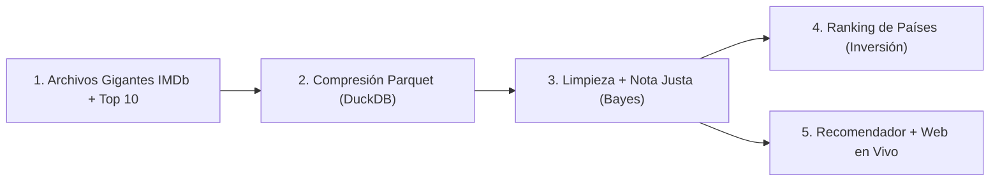

# 🎬 Guía Sencilla y Completa del Proyecto: Netflix Global Analytics

Este documento explica **de principio a fin y en palabras simples** cómo está armado el proyecto, dónde está cada archivo, qué hace cada algoritmo matemático por detrás y cómo funciona la plataforma web interactiva.

---

## 1. ¿Cuál es el objetivo del proyecto? (En pocas palabras)

Netflix tiene dos desafíos gigantescos hoy en día:
1. **Decisión de Negocio (Inversión):** Hollywood es carísimo y está saturado. Netflix necesita decidir con datos reales **en qué país conviene abrir su próximo estudio propio de producción** (inversión grande y segura) y **en qué países conviene comprar licencias baratas de películas o series muy buenas pero poco conocidas** ("Joyas Escondidas").
2. **Experiencia del Usuario (Recomendación):** Cuando entrás a la aplicación, el catálogo tiene más de 130.000 títulos. Si solo te muestra lo de Estados Unidos, te aburrís; por eso construimos una **web idéntica a Netflix que aprende en vivo de lo que mirás**, descubre tus géneros, países y actores favoritos, y te recomienda cine internacional sin saltos molestos en la pantalla.

---

## 2. Mapa Sencillo de Archivos: ¿Qué hace cada uno?

Para no perderse en las carpetas, así se divide todo el trabajo:

```text
Netflix/
│
├── run_app.py                  👉 EL BOTÓN DE ENCENDIDO: Ejecutás este archivo y levanta toda la web sola.
├── server.py                   👉 EL CEREBRO DE LA WEB (Backend): Conecta los datos con la pantalla del navegador.
├── main.py                     👉 EL PROCESADOR DE DATOS: Corre las 5 etapas de limpieza y análisis desde cero.
├── recomendar.py               👉 MODO CONSOLA: Permite probar recomendaciones escribiendo en la terminal.
├── config.py                   👉 PANEL DE CONTROL: Guarda rutas de carpetas, puntajes de clics y parámetros.
├── leer_datasets.py            👉 CONECTOR INICIAL: Guarda las llaves (API Key) para pedir fotos y textos a TMDB.
│
├── data/                       📦 DATOS CRUDOS Y CACHÉ DE FOTOS/SINOPSIS
│   ├── *.tsv.gz                • Los 7 archivos gigantes originales de IMDb (películas, votos, actores, episodios).
│   ├── netflix_top10_*.tsv     • Datos oficiales de Netflix con cuántas horas reales se vio cada título por semana.
│   └── tmdb_titles_cache.json  • "Memoria rápida" con 1.849 películas ya traducidas al español, con póster y país real.
│
├── output/                     📊 RESULTADOS LISTOS PARA USAR
│   ├── parquet/                • Las bases de datos ya limpias y ultrarrápidas (pesan casi 90% menos que las originales).
│   ├── figures/                • Los 3 gráficos principales guardados como imágenes PNG de alta calidad.
│   └── reports/                • Resúmenes escritos automáticamente con los números de cada etapa.
│
├── src/                        🧠 MÓDULOS DE CIENCIA DE DATOS (Uno por cada tarea)
│   ├── stage1_ingestion.py     • Etapa 1: Lee los archivos gigantes sin colgar la memoria RAM y los pasa a Parquet.
│   ├── stage2_eda_cleaning.py  • Etapa 2: Limpia errores, une tablas sin duplicar y calcula el "Promedio Bayesiano".
│   ├── stage3_history_trends.py• Etapa 3: Analiza cómo creció el cine extranjero del VHS al Streaming (1980-2024).
│   ├── stage4_hubs_decision.py • Etapa 4: Arma el ranking de países para decidir dónde invertir.
│   ├── stage5_recommender.py   • Etapa 5: El recomendador que cruza géneros, países y actores.
│   ├── actor_graph.py          • Red de Actores: Conecta qué actores trabajaron juntos para sugerirte nuevos elencos.
│   ├── tmdb_client.py          • Buscador de Imágenes: Pide a internet (TMDB) pósters, tráilers y resúmenes en español.
│   ├── paises.py               • Traductor de Países: Convierte códigos como "AR" en "AR - Argentina".
│   └── generar_graficos.py     • Dibuja los gráficos estadísticos de respaldo.
│
└── web/                        🖥️ LA PÁGINA WEB (Lo que ves en el navegador)
    ├── index.html              • El esqueleto de la página (barra superior, inicio, Mi Lista, modal y pestaña ejecutiva).
    ├── css/netflix.css         • El diseño visual oscuro, animaciones al pasar el mouse y barras desplazadoras.
    └── js/app.js               • La interactividad: detecta dónde dejás el mouse, reproduce tráilers y dibuja los mapas.
```

---

## 3. ¿Cómo se procesan los datos paso a paso? (Las 5 Etapas sin tecnicismos)



### Etapa 1: Cómo abrir archivos gigantes sin que se tilde la computadora (`stage1_ingestion.py`)
* **El problema:** Los archivos originales de IMDb tienen más de **40 millones de renglones**. Si los abrís de golpe de forma común (con `pandas`), llenan toda la memoria RAM y el programa se cierra.
* **Cómo lo resolvimos de forma simple:**
  1. Usamos **DuckDB**, un motor ultrarrápido que lee los archivos comprimidos directo desde el disco duro sin cargarlos enteros en memoria.
  2. **Achicamos el tamaño de los números (*Downcasting*):** Por defecto, Python guarda un año como `2024` ocupando un espacio gigante (64 bits). Nosotros le dijimos que use cajitas chiquitas (`Int16` para años, `Int8` para sí/no).
  3. **Formato Parquet:** Guardamos todo en archivos `.parquet` (en `output/parquet/`). Así, una tabla que pesaba **218 MB** bajó a **27,4 MB (-87%)** y se lee en milisegundos.

### Etapa 2: Unir tablas sin errores y calcular una "Nota Justa" (`stage2_eda_cleaning.py`)
Aquí resolvimos **4 trampas clásicas** de los datos:
1. **Evitar que se multipliquen las filas:** En el archivo `title.akas`, una misma película aparece 60 veces (una por cada país donde se estrenó). Si unís esa tabla directo con la de películas, esa película se contaría 60 veces. Primero **resumimos** `title.akas` para que quede **1 sola fila por película** diciendo *"se estrenó en 60 países y en 12 idiomas"*.
2. **Eliminar películas homónimas falsas:** Había películas desconocidas que se llamaban igual que series famosas (por ejemplo, una película independiente de 2009 llamada *"You"* se confundía con la serie famosa *"You"* de Netflix). El sistema ordena por cantidad de votos y le asigna las horas de éxito de Netflix **únicamente a la obra original verdadera** (se limpiaron 2.805 casos repetidos).
3. **Corregir el verdadero país de origen:** Como las películas famosas se estrenan en todo el mundo, IMDb mezclaba los países de distribución. Cruzamos los títulos con los datos de **idioma original y país productor de TMDB** para garantizar que *El secreto de sus ojos* y *Relatos salvajes* figuren como **`AR - Argentina`**, *Dark* como **`DE - Alemania`** y *The Shawshank Redemption* como **`US - Estados Unidos`**.
4. **El Promedio Bayesiano (La "Nota Justa"):**
   * *¿Por qué el promedio común miente?* Imaginate una película casera que votaron solo el director y su mamá y le pusieron un **10**, contra *El Padrino* que votaron 2 millones de personas y tiene **9,2**. Si ordenás por promedio simple, ¡gana la película casera!
   * *¿Cómo funciona nuestra fórmula?*
     $$WR = \left(\frac{v}{v + m}\right) \cdot R + \left(\frac{m}{v + m}\right) \cdot C$$
     En palabras simples: mientras una película tiene **pocos votos ($v$)**, el sistema "desconfía" y acerca su nota al **promedio mundial ($C = 6,82$)**. Recién cuando supera los **$m = 1.002$ votos**, su nota real ($R$) pesa con toda su fuerza. Así eliminamos el spam y el *review bombing*.
5. **Embudo de Limpieza (*Waterfall*):** De **1.130.064** títulos iniciales, tras quitar cortometrajes, fechas imposibles (como series del año 1900 con capítulos del 2000) y títulos con menos de 100 votos, nos quedamos con **132.887 películas y series 100% confiables**.

### Etapa 3: Historia del Cine Internacional: ¿Tecnología o Calidad? (`stage3_history_trends.py`)
Dividimos la historia en 4 épocas: **Era VHS (1980-1996)**, **Era DVD (1997-2009)**, **Inicio del Streaming (2010-2016)** y **Streaming Global actual (2017-2024)**.
* **Hallazgo clave:** En la época del VHS, solo el **41%** del cine fuera de EE.UU. lograba viajar a más de 10 países. Hoy, con el streaming global y el doblaje simultáneo, el **63,4% de las producciones no inglesas** cruza fronteras (¡incluso superando en proporción al cine estadounidense!).

### Etapa 4: ¿Dónde debe invertir Netflix? (`stage4_hubs_decision.py`)
Para cada país medimos dos cosas simples frente al promedio mundial:
* **Calidad (*Rating Lift*):** ¿Sus películas gustan más que el promedio mundial de `6,51`?
* **Viaje Internacional (*Reach Lift*):** ¿Sus películas llegan a más países que el promedio mundial de `13,6`?
* **Decisión final basada en datos:**
  * **Escenario A — Abrir un Estudio Propio (Inversión Fuerte):** **Corea del Sur (`KR`)**. Tiene altísima calidad (`6,86`), viaja a más de `20,7` países en promedio y acumula casi **2.900 millones de horas vistas** en el Top 10 de Netflix. (Con la advertencia de que sus costos locales están subiendo por competencia con Disney+ y Apple).
  * **Escenario B — Comprar Licencias Baratas (*First-Look Deals* / Joyas Escondidas):** Mercados como **Dinamarca (`DK`), India (`IN`), España (`ES`) y Argentina (`AR`)**, donde hay enorme calidad crítica a una fracción de lo que cuesta filmar en Hollywood.

---

## 4. ¿Cómo funciona la Aplicación Web por dentro?

Cuando abrís `http://127.0.0.1:8000`, todo lo que hacés interactúa en vivo con Python:

### A. Cómo aprende de tus gustos sin molestarte
1. **Detector de Interés Real (Regla de los 0,8 segundos):** Si pasás el mouse rápido por arriba de una carátula por accidente, no pasa nada. Pero si te quedás mirando una tarjeta **más de 0,8 segundos (`800 ms`)**, el sistema entiende que te llamó la atención y suma **+1 punto** a ese género y país.
2. **Escala de puntos:**
   * Mirar una tarjeta (`hover >= 0.8s`) = **+1 pto**
   * Hacer clic en la tarjeta = **+3 ptos**
   * Abrir el panel de información (`Más info`) = **+5 ptos**
   * Hacer clic en un actor = **+6 ptos**
   * Guardar en **`Mi Lista`** = **+10 ptos**
3. **Memoria fresca (Olvido gradual del 5%):** Cada vez que hacés algo nuevo, tus gustos viejos se multiplican por `0,95`. Así, si arrancaste mirando comedias pero ahora tenés ganas de ver suspenso coreano, el sistema se adapta enseguida a lo que querés ver **hoy**.
4. **Actualización sutil (Sin saltos en la cara):** Si estás mirando una fila de películas en ese momento, la página **no te cambia toda la fila de golpe frente a tus ojos**. Agrega las nuevas sugerencias suavemente al final del carrusel y recién reordena la fila completa cuando bajás o cerrás una ventana.
5. **Desbloqueo de "💎 Joyas Escondidas para vos":** Cuando sumás **15 puntos** de interacción, el sistema ya te conoce lo suficiente y habilita un carrusel especial de películas muy buenas pero poco famosas que encajan justo con tu perfil.

### B. El Grafo de Actores (`actor_graph.py`): "Los compañeros de tus actores favoritos"
Armamos una red gigante con **66.030 actores y 246.350 conexiones**.
* **¿Cómo funciona?** Si mirás películas de **Ricardo Darín** o **Morgan Freeman** (*1er salto / 1-Hop*), el sistema busca en la red con qué otros grandes actores trabajaron en películas bien puntuadas (*2do salto / 2-Hop*, por ejemplo *Soledad Villamil*, *Leonardo Sbaraglia* o *Clint Eastwood*) y te sugiere sus películas explicándote la conexión.
* **Podés verlo dibujado en vivo:** Presionando **`Ctrl + D`** (o el botón superior **`⚙ Grafo & IA`**), se abre una ventanita que te dibuja en vivo los circulitos verdes (tus actores directos) unidos con líneas a los circulitos dorados (co-estrellas descubiertas).

### C. Pósters Inteligentes (*Contextual Bandit*), Series y Buscador Unificado
* **Pósters adaptativos (*Bandit*):** El sistema prueba qué tipo de portada te hace hacer más clics (póster clásico de éxito global vs. póster centrado en los actores protagonistas).
* **Series como en Netflix real:** Si abrís una serie (ej. *Dark*, *Stranger Things*, *Bridgerton*), podés elegir la **Temporada**, ver cada capítulo en español con su **duración en minutos**, reproducir el **Tráiler Oficial de YouTube** ahí mismo y ver cuál es el **🔥 Episodio Gancho (*Hook Episode*)**, es decir, el capítulo exacto donde la serie atrapa a la audiencia.
* **Buscador todo-en-uno:** Si escribís en la lupa el nombre de una película, un género (*"Acción"*, *"Terror"*), un actor o **un país** (por ejemplo escribís **`Argentina`** o **`argentino`**), desaparecen las filas del inicio y te aparecen **los actores destacados de ese país** arriba (para filtrar con un clic) seguidos de todas las películas de ese país y similares.

### D. La Pestaña Ejecutiva: "Países con Mayor Potencial"
Pensada para responder la pregunta de negocio frente a directivos:
1. **Mapa Mundial Interactivo y Gráfico de Cuadrantes:** Podés cambiar el color del mapa por Potencial, Calidad, Exportación o Efecto Doblaje. Si tocás cualquier país, carga su ficha técnica.
2. **Matriz de Doblaje vs. Subtitulado:** Muestra con barras reales cómo doblar una obra a 4 o más idiomas multiplica hasta por **3x u 8x** la cantidad de países a los que llega.
3. **Simulador de Inversión (Slider de USD 10M a 150M):** Movés la barra de plata y te calcula cuántas producciones originales podrías hacer en ese país, cuántas horas de streaming sumarías y cuánto ahorrás comparado con filmar en EE.UU.
4. **Comparador Mano a Mano (*Head-to-Head*):** Te deja enfrentar dos países (ej. *Corea del Sur vs. Argentina* o *España vs. Dinamarca*) y te da el ganador automático.
5. **Descarga directa a Excel (CSV) o PDF:** Con un botón arriba a la derecha.

---

## 5. Cómo encenderlo y cómo mostrarlo en 2 minutos

### Para arrancarlo en tu computadora:
```powershell
python run_app.py
```
*(Se abre solo en `http://127.0.0.1:8000`)*.

### Recorrido ideal para una presentación o defensa oral:
1. **Mostrá el Inicio:** Señalá el Hero en español, reproducí el tráiler embebido de *Stranger Things* y bajá haciendo scroll para mostrar cómo el **Scroll Infinito** inventa categorías nuevas.
2. **Abrí el Panel `⚙ Grafo & IA` (`Ctrl + D`):** Dejalo abierto en una esquina, pasá el mouse 1 segundo sobre 2 películas y guardá una en **`+ Mi Lista`**. Mostrá cómo sube la barra, se dibuja la red de actores y se desbloquean las *Joyas Escondidas*.
3. **Abrí una Serie (ej. *Dark* o *Bridgerton*):** Mostrá las temporadas, la duración de cada episodio y el indicador de **🔥 Episodio Gancho**.
4. **Probá el Buscador:** Escribí **`Argentina`** para mostrar cómo detecta los actores argentinos y el cine nacional sin mezclar las categorías del inicio.
5. **Cerrá en `Países con Mayor Potencial`:** Tocá distintos países en el Mapa Mundial, mové el **Simulador de Inversión en USD** y mostrá la conclusión ejecutiva entre **Corea del Sur (Estudio Propio)** y **Dinamarca/Hispanoamérica (Joyas Escondidas)**.
