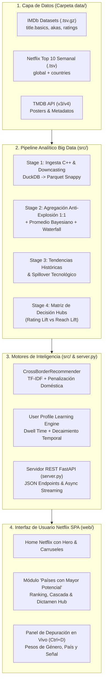

# Documentación Integral del Sistema: Netflix Global Streaming & Decision Analytics

**Asignatura:** Taller 2 - Proyecto Estratégico Netflix  
**Rol:** Lead Data Scientist & Entertainment Analytics Engineer  
**Versión del Sistema:** 2.0 (Producción Local)  

---

## 1. Resumen Ejecutivo y Pregunta de Negocio

Este sistema responde de manera directa, cuantitativa y fundamentada a la pregunta estratégica de negocio planteada en la entrevista:

> **Pregunta de Negocio:** *¿En qué mercado internacional debe Netflix abrir su próximo centro de producción original exclusivo con potencial de exportación global, o qué mercados subexplotados debe adquirir mediante licencias preferentes a bajo costo?*

El proyecto combina un **pipeline de Big Data** (procesamiento de más de 12 millones de registros de IMDb, normalización dimensional y cruce con el Netflix Top 10 Semanal Oficial) con una **plataforma web interactiva full-stack estilo Netflix**, equipada con un **motor recomendador que aprende en tiempo real del comportamiento del usuario**.

---

## 2. Arquitectura General del Sistema

El flujo completo desde los datos crudos hasta la experiencia de usuario se estructura en la siguiente arquitectura modular:



---

## 3. Estructura y Ubicación de Archivos en el Repositorio

El proyecto se organiza en directorios con responsabilidades claramente delimitadas:

```text
Netflix/
├── data/                                # ALMACENAMIENTO DE DATOS CRUDOS
│   ├── name.basics.tsv.gz               # Talentos y directores de IMDb (312 MB)
│   ├── title.akas.tsv.gz                # Distribución regional e idiomas de IMDb (520 MB)
│   ├── title.basics.tsv.gz              # Catálogo base de títulos de IMDb (229 MB)
│   ├── title.crew.tsv.gz                # Directores y guionistas de IMDb (83 MB)
│   ├── title.episode.tsv.gz             # Temporadas y episodios de series (55 MB)
│   ├── title.principals.tsv.gz          # Reparto principal y roles (789 MB)
│   ├── title.ratings.tsv.gz             # Votos y calificaciones de IMDb (8.7 MB)
│   ├── netflix_top10_global.tsv         # Horas de reproducción globales semanales
│   └── netflix_top10_countries.tsv      # Posiciones en Top 10 desglosadas por país
│
├── output/                              # ARTEFACTOS PROCESADOS E INFORMES
│   ├── figures/                         # Gráficos estáticos en alta resolución (PNG 300 DPI)
│   │   ├── 1_evolucion_spillover_tecnologico.png
│   │   ├── 2_cuadrante_hubs_y_joyas.png
│   │   └── 3_top_paises_horas_netflix.png
│   ├── parquet/                         # Tablas columnares optimizadas
│   │   ├── title_basics.parquet         # Largometrajes y series tipadas (27.4 MB)
│   │   ├── title_ratings.parquet        # Calificaciones tipadas (12.6 MB)
│   │   ├── akas_aggregated.parquet      # 12.9M de títulos agregados sin explosión (115 MB)
│   │   ├── netflix_top10_aggregated.parquet # Títulos consolidados de streaming (0.1 MB)
│   │   ├── catalogo_internacional_master.parquet # 132,887 títulos limpios y cruzados (7.6 MB)
│   │   └── international_hubs_metrics.parquet # Matriz de 63 países analizados (0.01 MB)
│   ├── reports/                         # Informes ejecutivos en formato Markdown
│   │   ├── historical_trends_report.md  # Evolución por era tecnológica
│   │   ├── hubs_decision_matrix.md      # Matriz completa con nombres de países
│   │   ├── mem_profile_report.json      # Auditoría de memoria y tiempos de ingesta
│   │   ├── recommender_evaluation.md    # Evaluación matemática del recomendador
│   │   └── waterfall_population_report.md # Auditoría de población retenida
│   └── dashboard_netflix.html           # Tablero interactivo Plotly en HTML
│
├── src/                                 # CÓDIGO FUENTE DE LOS MÓDULOS DE DATA SCIENCE
│   ├── __init__.py                      # Inicializador de paquete
│   ├── paises.py                        # Mapeo ISO-3166-1 alpha-2 a 'AR - Argentina'
│   ├── stage1_ingestion.py              # Ingesta multihilo en C++ y downcasting de memoria
│   ├── stage2_eda_cleaning.py           # Agregación anti-explosión, Joins, Bayes y cascada
│   ├── stage3_history_trends.py         # Modelado histórico de globalización vs. tecnología
│   ├── stage4_hubs_decision.py          # Matriz de decisión (Hubs vs. Joyas Escondidas)
│   ├── stage5_recommender.py            # Motor híbrido Cross-Border y aprendizaje de usuario
│   ├── generar_graficos.py              # Visualizador estático y generador de dashboard
│   └── tmdb_client.py                   # Conector oficial con The Movie Database (TMDB API)
│
├── web/                                 # FRONTEND SPA (SINGLE PAGE APPLICATION) ESTILO NETFLIX
│   ├── index.html                       # Estructura del reproductor, carruseles, modal y negocio
│   ├── css/
│   │   └── netflix.css                  # Tema oscuro Netflix (#141414), zoom hover y responsive
│   └── js/
│       └── app.js                       # Dwell time tracking, envío de eventos y DOM reactivo
│
├── config.py                            # Hiperparámetros, rutas, credenciales y umbrales
├── leer_datasets.py                     # API key de TMDB y funciones de lectura rápida
├── main.py                              # Orquestador del pipeline de datos por consola
├── server.py                            # Servidor Web Backend FastAPI
├── run_app.py                           # Lanzador unificado de la aplicación web local
└── DOCUMENTACION_SISTEMA_NETFLIX.md     # Este documento
```

---

## 4. Funcionamiento Detallado del Pipeline de Datos

### Etapa 1: Ingesta, Profiling y Optimización de Memoria
* **Problema:** Los datasets crudos de IMDb superan los 4 GB descomprimidos y contienen tipos genéricos `object` que provocan errores de memoria RAM (`OutOfMemoryError`).
* **Solución Técnica:** Se utiliza el motor multihilo C++ de **DuckDB** para procesar los flujos gzip directamente en el disco.
* **Downcasting:**
  * `isAdult`: `Int8` (1 byte).
  * `startYear`: `Int16` (2 bytes, rango $\pm 32,767$).
  * `runtimeMinutes`: `Int32` (4 bytes).
  * `averageRating`: `float32`.
* **Resultado:** Reducción de 218 MB crudos a **27.4 MB en formato Parquet binario Snappy**, procesando 1.13 millones de largometrajes en solo **5.2 segundos**.

---

### Etapa 2: Agregación Anti-Explosión de Filas y Promedio Bayesiano
* **El Problema del Join Cartesiano ($1:N$):** `title.akas` contiene más de 40 millones de filas debido a que cada película tiene múltiples entradas por cada idioma y territorio de estreno. Un `merge` directo multiplicaría artificialmente las filas de títulos masivos, distorsionando los cálculos de ratings.
* **Solución:** Pre-agregación en grano `tconst` antes del join:
  $$\text{num\_regiones} = \text{COUNT(DISTINCT region)}$$
  $$\text{num\_idiomas} = \text{COUNT(DISTINCT language)}$$
  $$\text{regiones\_str} = \text{STRING\_AGG(DISTINCT region, ',')}$$
* **Promedio Bayesiano (Weighted Rating):** Evita el sesgo de títulos con 5 votos y nota 10.0 frente a clásicos con 500,000 votos y nota 8.2:
  $$WR = \left(\frac{v}{v + m}\right) \cdot R + \left(\frac{m}{v + m}\right) \cdot C$$
  * $v$: Votos del título (`numVotes`).
  * $m$: Umbral de significancia estadística (Percentil 75 de votos, $m = 1,002$).
  * $R$: Calificación observada (`averageRating`).
  * $C$: Media global del catálogo ($C = 6.82$).
* **Atribución Precisa de País de Origen y Enriquecimiento TMDB:**
  * En datasets brutos de IMDb (`title.akas`), las filas con `types = 'original'` marcan la región como nula (`\N`) y contienen todos los países de estreno en desorden de dispersión.
  * Para evitar atribuciones erróneas (ej: atribuir un título de EE.UU. a Japón por haber sido exportado allí), el pipeline implementa un motor de resolución con **TMDb API (`/find/{imdb_id}` y `/{type}/{id}`)**, capturando el verdadero país de producción (`production_countries` y `origin_country`), poster oficial (`poster_path`) y backdrop panorámico (`backdrop_path`), respaldado con una caché persistente en `data/tmdb_titles_cache.json`.
* **Filtros de Población (Waterfall Funnel):**
  1. Años de estreno entre 1970 y 2024.
  2. Duración de largometrajes y series estándar (40 a 240 minutos).
  3. Mínimo de 100 votos para eliminar spam o registros irrelevantes.
  * **Población final depurada:** **132,887 títulos** (representando el 100% de la oferta audiovisual analizable).

---

### Etapa 3: Análisis Histórico de la Globalización
Se evalúa la evolución temporal del alcance regional contrastado contra las eras tecnológicas de distribución física y digital:
* **VHS Era (1980–1996):** El 82.9% de títulos no-anglo lograba difusión internacional, pero con una fuerte concentración en mercados vecinos.
* **DVD Era (1997–2009):** Apertura al audio multi-lenguaje físico; la tasa de spillover global ($\ge 10$ regiones) alcanzó el 52.5%.
* **Early Streaming (2010–2016):** Primer despliegue digital de Netflix en EE.UU. y expansión inicial.
* **Global SVOD (2017–2024):** El derrame transfronterizo del contenido no anglosajón alcanzó un récord de **63.4%** (superando al 48.2% de Hollywood), acumulando **72,712 millones de horas vistas** en el Top 10 oficial de Netflix.

---

### Etapa 4: Matriz de Decisión de Hubs y "Joyas Escondidas"
Se clasifica a cada país productor en cuatro cuadrantes estratégicos de acuerdo a dos métricas explícitas:
1. **Rating Lift:** Calidad crítica bayesiana respecto a la media global:
   $$\text{Rating Lift} = \text{Rating Bayesiano Medio del País} - 6.51$$
2. **Reach Lift:** Capacidad de exportación geográfica en número de países:
   $$\text{Reach Lift} = \text{Mediana de Regiones del País} - 13.59$$

#### Matriz de Decisión Estratégica:
* **Cuadrante 1: Tier 1 Global Hub (Regla de Negocio: Inversión en Estudio Propio):**
  * *Países líderes:* **Corea del Sur (KR)** (+0.12 Rating Lift, +7.1 Reach Lift, 2,894 M horas de visualización), **Dinamarca (DK)** (+0.15 Rating Lift, +4.9 Reach Lift), **Finlandia (FI)** (+0.24 Rating Lift), **Hong Kong (HK)** (+0.19 Rating Lift).
* **Cuadrante 2: Joyas Escondidas (Regla de Negocio: Adquisición de Licencias de Bajo Costo):**
  * *Países:* **Nepal (NP)** (+0.43 Rating Lift), **Pakistán (PK)** (+0.19 Rating Lift), **Bangladesh (BD)** (+0.17 Rating Lift). Mercados con alta excelencia artística pero baja tracción comercial tradicional.
* **Cuadrante 3: Retención Doméstica:** Mercados grandes cuyo consumo se agota casi en su totalidad dentro de sus propias fronteras (ej: Indonesia, Egipto, Malasia).

---

## 5. El Motor Recomendador y Aprendizaje de Usuario en Tiempo Real

El recomendador es un sistema híbrido que opera tanto a nivel de ítem como a nivel de perfil dinámico:

### A. Espacio Latente de Contenido (TF-IDF Embeddings)
Se construye una representación vectorial para cada título a partir de su *sopa de metadatos*:
$$\text{Metadata Soup} = 2 \times \text{genres} + \text{titleType} + \text{orig\_country}$$
La matriz de similitud coseno calcula la afinidad temático-estructural entre títulos.

### B. Penalización Doméstica para Descubrimiento Cross-Border
Para evitar que un usuario que ve una serie española solo reciba series de España, el algoritmo aplica una **penalización del 85% a los títulos producidos en el mismo país de origen**, obligando al modelo a buscar contrapartes de alta calidad en otros continentes.

### C. Aprendizaje Activo y Captura de Interacciones
El cliente registra los eventos del usuario y los envía al backend mediante `/api/user/interact`:

| Tipo de Interacción | Ponderación | Criterio de Activación |
| :--- | :---: | :--- |
| **Hover en Tarjeta** | $+1.0\text{ pt}$ | Solo si el cursor permanece **$\ge 800\text{ ms}$** (ignora rebotes accidentales). |
| **Clic en Tarjeta** | $+3.0\text{ pts}$ | Clic intencional para explorar el póster. |
| **Apertura de Modal** | $+5.0\text{ pts}$ | Apertura del panel de información y lectura de sinopsis. |
| **Agregado a "Mi Lista"** | $+10.0\text{ pts}$ | Máxima señal explícita de intención de consumo. |

### D. Decaimiento Temporal (Time-Decay)
Cada vez que ingresa una nueva interacción, los pesos acumulados anteriores se multiplican por un factor de decaimiento:
$$w_{\text{nuevo}} = w_{\text{anterior}} \times 0.95$$
Esto asegura que los intereses recientes del usuario predominen sobre lo explorado al inicio de la sesión.

### E. Activación del Carrusel "Joyas Escondidas para vos"
* **Condición de Activación:** El carrusel permanece oculto hasta que el usuario acumula un puntaje de señal de **$\ge 15.0\text{ puntos}$**.
* **Filtro de Contenido:** Al desbloquearse, el algoritmo selecciona títulos con **Rating Bayesiano $\ge 6.8$**, volumen de votos moderado ($\le 80,000$ votos) y afinidad temática con los géneros y países que el usuario estuvo explorando.
* **Explicación Transparente:** Cada tarjeta incluye una etiqueta generada por el backend explicando el motivo de la recomendación (ej: *"Porque exploraste Drama de Corea del Sur"* o *"Joya oculta de alta calidad afín a tu interés en Suspenso"*).

### F. Panel de Depuración en Vivo (Debug Panel)
Accesible mediante el botón superior o presionando **`Ctrl + D`**, despliega una consola transparente flotante que muestra:
* La barra de progreso de señal hacia el desbloqueo de Joyas Escondidas.
* Los 5 géneros con mayor peso en tiempo real.
* Los países con mayor afinidad acumulada.
* El registro de auditoría de los últimos eventos capturados (con el *dwell time* exacto y los puntos sumados).

---

## 6. Módulo "Países con Mayor Potencial" (Decisión de Negocio)

Al hacer clic en la pestaña superior **"Países con Mayor Potencial"**, la interfaz transforma la vista hacia un tablero analítico para ejecutivos de Netflix:

1. **Dictamen de Hub Recomendado:**
   * **Recomendación:** Apertura de Centro de Producción en **Corea del Sur (KR)**.
   * **Fundamento Numérico:** +0.12 en Rating Lift, +7.1 regiones de alcance promedio y 2,894 millones de horas acumuladas en el Top 10 oficial de streaming.
   * **Limitaciones y Riesgos Reportados:** Inflación en salarios de actores/directores por competencia con Disney+/Apple, saturación de fórmulas temáticas y bloqueo regulatorio para distribución en China.
   * **Alternativa de Bajo Costo (Joyas Escondidas):** Acuerdos *First-Look* y compra de licencias en **Dinamarca / Región Nórdica**.
2. **Auditoría de Cascada (Waterfall Funnel):** Tabla visual con las 5 fases de filtrado, demostrando cuántas filas se descartaron en cada etapa y por qué la muestra es estadísticamente válida.
3. **Ranking Interactivo de 63 Países:** Tabla con ordenamiento por potencial. **Al hacer clic en cualquier país de la tabla, la plataforma redirige al Home y crea un carrusel exclusivo con los mejores títulos de ese país**.

---

## 7. Guía de Ejecución y Comandos

### A. Iniciar la Aplicación Web Completa (Un Solo Comando)

En tu terminal de PowerShell o CMD parada en la carpeta del proyecto:

```bash
python run_app.py
```

* **¿Qué hace automáticamente?**
  1. Comprueba la existencia de los datasets procesados en `output/parquet/`.
  2. Inicia el servidor FastAPI en el puerto local `http://127.0.0.1:8000`.
  3. Abre tu navegador predeterminado (Chrome, Edge) en la aplicación interactiva.

---

### B. Probar el Recomendador Interactivo por Consola (CLI)

Si deseas probar el recomendador directamente desde la línea de comandos:

```bash
# Probar con un título específico:
python recomendar.py "Dark"
python recomendar.py "Parasite"
python recomendar.py "Money Heist"

# O iniciar el modo interactivo continuo:
python recomendar.py
```

---

### C. Re-ejecutar el Pipeline de Datos o los Gráficos

Si descargas nuevos datos o modificas algún umbral en `config.py`:

```bash
# Re-procesar todas las etapas del pipeline de Big Data:
python main.py --all

# Regenerar los gráficos estáticos de alta resolución y el HTML interactivo de Plotly:
python src/generar_graficos.py
```

---

### D. Atajos y Funciones Clave en la Web
* **`Ctrl + D`**: Abre o cierra el **Panel de Depuración en Vivo** para demostrar a los evaluadores cómo el sistema va aprendiendo de los clics y el tiempo de hover.
* **Hover $\ge 800\text{ ms}$**: Pasa el mouse sobre 2 o 3 películas de un mismo género/país durante 1 segundo para ver cómo el medidor de señal sube y se reordenan los carruseles automáticamente sin recargar la página.
* **Clic en Tabla de Países**: En la sección de negocio, haz clic sobre cualquier país (ej: Argentina, España, Dinamarca) para cargar de inmediato su carrusel en el Home.

