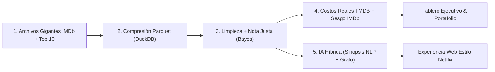

# 🎬 Guía Sencilla y Completa del Proyecto: Netflix Global Analytics (v6.0)

Este documento explica **de principio a fin y en palabras simples** cómo está armado todo el proyecto, dónde está cada archivo, cómo funcionan sus modelos de Ciencia de Datos e Inteligencia Artificial por detrás y cómo aprovechar todas las herramientas interactivas de la plataforma web.

---

## 1. ¿Cuál es el objetivo del proyecto? (En pocas palabras)

Netflix enfrenta dos grandes desafíos hoy en día:
1. **Decisión de Negocio (Inversión Internacional):** Producir en Hollywood es carísimo (mediana de **USD 22 millones** por película) y el mercado anglosajón está saturado. Netflix necesita decidir con datos reales **en qué país abrir su próximo estudio propio de producción** (*Escenario A*) y **en qué mercados comprar licencias económicas de películas o series excelentes pero poco conocidas** (*Escenario B: "Joyas Escondidas"*).
2. **Experiencia del Usuario (Recomendación Inteligente):** Con más de **132.000 títulos** depurados, mostrar solo lo de EE.UU. aburre al usuario. Construimos una **plataforma idéntica a Netflix real** que aprende en vivo de lo que mirás, entiende de qué tratan las historias (NLP sobre sinopsis), recorre la red de actores que trabajaron juntos, acepta tus `👍 / 👎` y guarda tus perfiles de forma permanente.

---

## 2. Mapa Sencillo de Archivos: ¿Qué hace cada uno?

```text
Netflix/
│
├── run_app.py                     👉 BOTÓN DE ENCENDIDO: Ejecutás este archivo y levanta toda la web sola.
├── server.py                      👉 CEREBRO DE LA WEB (FastAPI): Búsquedas, perfiles, recomendador y optimizador.
├── main.py                        👉 PROCESADOR DE DATOS: Ejecuta las 5 etapas de limpieza y análisis desde cero.
├── recomendar.py                  👉 MODO CONSOLA: Permite probar recomendaciones escribiendo en la terminal.
├── config.py                      👉 PANEL DE CONTROL: Rutas, puntajes de interacción y carga segura de .env.
├── leer_datasets.py               👉 CONECTOR INICIAL: Carga variables privadas (.env) y verifica datasets locales.
├── .env.example                   👉 PLANTILLA DE CREDENCIALES: Ejemplo seguro para configurar tu API Key de TMDB.
├── Dockerfile / render.yaml       👉 NUBE EN 1 CLIC: Listo para subir la aplicación a internet con Docker o Render.
│
├── data/                          📦 DATOS CRUDOS, CACHÉ EN ESPAÑOL Y SESIONES PERSISTENTES
│   ├── *.tsv.gz                   • Los 7 archivos originales de IMDb (+40 millones de filas en title.akas).
│   ├── netflix_top10_*.tsv        • Horas reales vistas por semana del ranking oficial de Netflix.
│   ├── tmdb_titles_cache.json     • Memoria rápida con +1.850 títulos en español, pósters, tráilers y presupuestos USD.
│   └── user_sessions.db           • Base SQLite donde se guardan tus perfiles, "Continuar viendo" y "Mi Lista".
│
├── output/                        📊 RESULTADOS, AUDITORÍAS Y GRÁFICOS LISTOS
│   ├── parquet/                   • Tablas ultrarrápidas comprimidas (-87% de peso, 0% de duplicados).
│   ├── figures/                   • Gráficos estadísticos exportados en alta definición (.png).
│   └── reports/                   • Reportes automáticos (evaluación Recall@10 y auditoría de presupuestos/sesgo).
│
├── src/                           🧠 MÓDULOS DE CIENCIA DE DATOS E INGENIERÍA
│   ├── stage1_ingestion.py        • Etapa 1: Lee los archivos gigantes con DuckDB sin colgar la memoria RAM.
│   ├── stage2_eda_cleaning.py     • Etapa 2: Limpia errores, quita homónimos y calcula la "Nota Justa" (Bayes).
│   ├── stage3_history_trends.py   • Etapa 3: Mide cómo creció el cine extranjero del VHS al Streaming (1980-2024).
│   ├── stage4_hubs_decision.py    • Etapa 4: Arma el ranking de países para decidir dónde invertir.
│   ├── stage5_recommender.py      • Etapa 5: Motor híbrido con NLP de sinopsis + géneros + países + actores + 👍/👎.
│   ├── actor_graph.py             • Red de Actores: Conecta a 66.030 actores según películas compartidas (1 y 2 saltos).
│   ├── evaluate_recommender.py    • Auditoría IA: Mide científicamente qué tan bien acierta el recomendador (Recall/NDCG).
│   ├── audit_budgets_and_bias.py  • Auditoría Financiera: Extrae costos reales en USD de TMDB y corrige el sesgo IMDb.
│   ├── session_store.py           • Memoria Permanente: Guarda y reinicia perfiles de usuario en SQLite (modo WAL).
│   ├── tmdb_client.py             • Cliente TMDB: Descarga pósters, tráilers de YouTube y textos en español.
│   └── paises.py                  • Diccionario Global: Convierte códigos ISO ("AR") en "AR - Argentina".
│
├── tests/                         ✅ CONTROL DE CALIDAD AUTOMÁTICO
│   └── test_netflix_system.py     • 7 pruebas integrales que verifican seguridad, datos, grafo, IA y funciones web.
│
└── web/                           🖥️ LA PÁGINA WEB INTERACTIVA (Estilo Netflix Premium)
    ├── index.html                 • Inicio con Hero rotativo, Perfiles, Sorprendeme, Modal y Tablero Ejecutivo.
    ├── css/netflix.css            • Números gigantes Top 10, Skeletons animados, barras integradas y animaciones.
    └── js/app.js                  • Toda la lógica en vivo: autocompletado, curva de episodios, mapas y portafolio.
```

---

## 3. ¿Cómo se procesan los datos paso a paso? (Sin palabras difíciles)



### Etapa 1: Abrir archivos gigantes sin colgar la computadora (`stage1_ingestion.py`)
Usamos **DuckDB** para leer desde disco los más de **40 millones de renglones** de `title.akas`, achicamos el tamaño numérico (*downcasting*) y guardamos todo en **Parquet Snappy** (**-87,4% de peso**, consulta instantánea).

### Etapa 2: Limpiar trampas y calcular la "Nota Justa" (`stage2_eda_cleaning.py`)
1. **Cero duplicados (Relación 1 a 1):** Resumimos los países e idiomas por película antes de unir tablas para nunca contar 60 veces el mismo título.
2. **Filtro de homónimos:** Evitamos que películas caseras llamadas igual que éxitos famosos (como *"You"* de 2009 vs. la serie *"You"* de Netflix) se roben sus horas vistas (**2.805 casos depurados**).
3. **País de origen real:** Verificado con el idioma original y productoras de TMDB (*El secreto de sus ojos* $\rightarrow$ `AR - Argentina`, *Dark* $\rightarrow$ `DE - Alemania`).
4. **Promedio Bayesiano ($WR$):**
   $$WR = \left(\frac{v}{v + m}\right) \cdot R + \left(\frac{m}{v + m}\right) \cdot C$$
   Evita que una película con 5 votos de amigos y nota 10 supere a un clásico votado por millones: recién al pasar los **$m = 1.002$ votos**, su nota propia ($R$) pesa por completo frente al promedio mundial ($C = 6,82$).

### Etapa 3 y 4: Historia del Streaming, Presupuestos Reales y Corrección de Sesgo
* **Del VHS al Streaming (`stage3`):** La exportación del cine no inglés saltó del **41,2%** en la era del VHS al **63,4%** en la era del streaming global con doblaje simultáneo.
* **Presupuestos Reales en USD (`audit_budgets_and_bias.py`):** Auditamos **253 producciones internacionales** en TMDB frente a los **USD 22,0M** de Hollywood. Filmar en **España (`USD 4,62M`)**, **Corea (`USD 7,96M`)**, **Noruega (`USD 4,80M`)** o **Argentina (`USD 3,24M`)** ahorra entre un **64% y un 85%** por título.
* **Corrección del Sesgo Geográfico de IMDb:** Como en Asia, África o Latinoamérica vota menos gente en IMDb que en EE.UU., calculamos el **Potencial Ajustado por Sesgo (`bias_adjusted_score`)** para evaluar con justicia a los mercados emergentes.

---

## 4. Todas las Funciones Visuales e Inteligentes de la Web

### A. Experiencia Visual Estilo Netflix Real
* **Carrusel Top 10 con Números Gigantes (`1` al `10`):** La fila principal dibuja los números gigantes bordeados detrás de cada póster e insignias **`TOP 10`** en los éxitos mundiales.
* **Hero Banner Rotativo con Vista Previa de Video:** La portada principal va rotando suavemente entre los **5 mayores éxitos globales**, con indicadores inferiores y botón **`🎞 Vista Previa`** para reproducir el tráiler de fondo.
* **Carga con *Skeletons* brillantes y bordes adaptativos:** Las tarjetas en los extremos nunca se cortan al hacer zoom.

### B. IA en Vivo, Perfiles Demo, *"Sorprendeme"* y Feedback `👍 / 👎`
* **Selector *"¿Quién está viendo ahora?"* (Arriba a la derecha):** Cambiá en 1 clic entre **`🎬 Tu Perfil`**, **`🐉 Fan K-Drama & Anime`**, **`🎭 Cine Argentino & Autor`** e **`✨ Invitado (Desde Cero)`**, o tocá **`↺ Reiniciar aprendizaje`** para volver a `0.0 pts` en vivo durante una presentación.
* **Botón `🎲 Sorprendeme`:** Elige automáticamente una joya internacional ideal para tu perfil, abre su tráiler y te muestra una caja dorada explicando **los 3 motivos matemáticos** por los que la seleccionó.
* **Botones `👍 Me gusta` y `👎 No me interesa`:** Presentes en cada tarjeta y dentro del modal. `👍` suma **+8 puntos** de afinidad; `👎` penaliza ese estilo y **oculta instantáneamente la película** para que no vuelva a recomendártela.
* **Fila *"▶ Continuar viendo"*:** Cada vez que mirás un tráiler o hacés clic en un capítulo de una serie, aparece automáticamente la fila *Continuar viendo* con su **barra roja de progreso**.
* **Validación Científica (`Recall@10 = 52,22%`):** Apretando **`Ctrl + D`** (`⚙ Grafo & IA`) ves dibujado en vivo el **Grafo de 66.030 Actores (`1-Hop -> 2-Hop`)** y la tabla del experimento *Leave-One-Out* donde nuestro motor supera por **4,5 veces** al recomendador tradicional por géneros (`52,22%` vs. `11,67%`).

### C. Modal Completo, Series con Curva de Episodios y Buscador con Autocompletado
* **Autocompletado instantáneo y filtros:** Al escribir en la lupa se despliegan sugerencias inmediatas de **🌍 Países**, **🎭 Actores** y **🎬/📺 Títulos**, y podés filtrar los resultados entre *Todo / Solo Películas / Solo Series* u ordenar por *Nota Bayesiana* o *Más Recientes*.
* **Curva de Calificación por Episodio + *Más títulos similares*:** En las series, además del selector de temporadas y el **🔥 Episodio Gancho**, ves dibujada la **curva de notas capítulo a capítulo**; y al pie de cualquier modal tenés **6 títulos similares** para seguir navegando sin salir.

### D. Tablero Ejecutivo con Optimizador Automático de Portafolio Multi-País
En **`Países con Mayor Potencial`** contás con:
1. **🌐 Optimizador de Portafolio Internacional (USD 40M a 400M):** Reparte matemáticamente un presupuesto global entre **5 mercados complementarios** (*Escenario A: Hub Propio en Corea* + *Escenario B: Joyas en España, Nórdicos, Argentina, etc.*), mostrando cuántos títulos más lográs frente a Hollywood y cuántas horas globales proyecta cada país.
2. **Mapa Mundial Plotly (7 métricas), Matriz de Doblaje, Evolución VHS-Streaming y Comparador Mano a Mano.**
3. **Tabla Ejecutiva Ordenable:** Hacé clic en cualquier columna (*Potencial*, *Potencial s/Sesgo*, *Costo TMDB*, *Doblaje*, *Horas*) para reordenar los mercados en vivo, o exportá todo a **Excel (CSV) / PDF**.

---

## 5. Cómo Encenderlo y Ejecutar los Tests

```powershell
# 1. Levantar la aplicación web (se abre en http://127.0.0.1:8000)
python run_app.py

# 2. Ejecutar las 7 pruebas automáticas de calidad
python -m unittest discover -s tests -v
```
