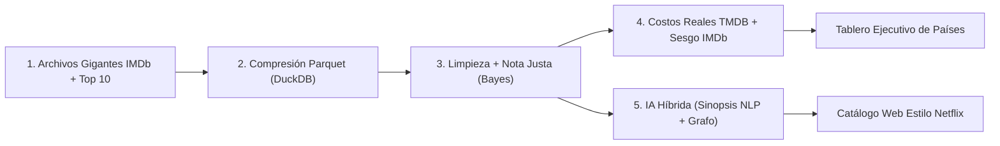

# 🎬 Guía Sencilla y Completa del Proyecto: Netflix Global Analytics (v5.0)

Este documento explica **de principio a fin y en palabras simples** cómo está armado todo el proyecto, dónde está cada archivo, cómo funcionan sus modelos de Ciencia de Datos e Inteligencia Artificial por detrás y cómo usar la plataforma web interactiva.

---

## 1. ¿Cuál es el objetivo del proyecto? (En pocas palabras)

Netflix enfrenta dos desafíos centrales hoy en día:
1. **Decisión de Negocio (Inversión Internacional):** Producir en Hollywood es carísimo (mediana de **USD 22 millones** por título) y el mercado está saturado. Netflix necesita decidir con datos reales **en qué país abrir su próximo estudio propio de producción** (*Escenario A*) y **en qué mercados comprar licencias económicas de películas o series excelentes pero poco conocidas** (*Escenario B: "Joyas Escondidas"*).
2. **Experiencia del Usuario (Recomendación Inteligente):** Con un catálogo depurado de más de **132.000 títulos**, mostrar solo éxitos de EE.UU. aburre al usuario. Construimos una **plataforma idéntica a Netflix que aprende en vivo de lo que mirás**, entiende de qué tratan las historias (NLP sobre sinopsis), recorre la red de actores que trabajaron juntos y actualiza tus recomendaciones de forma sutil y permanente.

---

## 2. Mapa Sencillo de Archivos: ¿Qué hace cada uno?

Así se organiza el proyecto carpeta por carpeta:

```text
Netflix/
│
├── run_app.py                     👉 BOTÓN DE ENCENDIDO: Ejecutás este archivo y levanta toda la web sola.
├── server.py                      👉 CEREBRO DE LA WEB (FastAPI): Conecta la base de datos, la IA y el navegador.
├── main.py                        👉 PROCESADOR DE DATOS: Ejecuta las 5 etapas de limpieza y análisis desde cero.
├── recomendar.py                  👉 MODO CONSOLA: Permite probar recomendaciones escribiendo en la terminal.
├── config.py                      👉 PANEL DE CONTROL: Rutas, umbrales de interacción y carga segura de .env.
├── leer_datasets.py               👉 CONECTOR INICIAL: Carga variables seguras (.env) y verifica datasets locales.
├── .env.example                   👉 PLANTILLA DE CREDENCIALES: Ejemplo seguro para configurar tu API Key de TMDB.
├── Dockerfile / render.yaml       👉 NUBE EN 1 CLIC: Archivos listos para subir la aplicación a internet (Docker/Render).
│
├── data/                          📦 DATOS CRUDOS, CACHÉ EN ESPAÑOL Y SESIONES PERSISTENTES
│   ├── *.tsv.gz                   • Los 7 archivos originales de IMDb (+40 millones de filas en title.akas).
│   ├── netflix_top10_*.tsv        • Horas reales vistas por semana del ranking oficial de Netflix.
│   ├── tmdb_titles_cache.json     • Memoria rápida con +1.850 títulos en español, pósters, tráilers y presupuestos USD.
│   └── user_sessions.db           • Base SQLite automática donde se guarda tu perfil aprendido y "Mi Lista".
│
├── output/                        📊 RESULTADOS, AUDITORÍAS Y GRÁFICOS LISTOS
│   ├── parquet/                   • Tablas ultrarrápidas comprimidas (-87% de peso, 0% de duplicados).
│   ├── figures/                   • Gráficos estadísticos exportados en alta definición (.png).
│   └── reports/                   • Reportes automáticos (incluyendo evaluación Recall@10 y auditoría de costos).
│
├── src/                           🧠 MÓDULOS DE CIENCIA DE DATOS E INGENIERÍA
│   ├── stage1_ingestion.py        • Etapa 1: Lee los archivos gigantes con DuckDB sin colgar la memoria RAM.
│   ├── stage2_eda_cleaning.py     • Etapa 2: Limpia errores, quita homónimos y calcula la "Nota Justa" (Bayes).
│   ├── stage3_history_trends.py   • Etapa 3: Mide cómo creció el cine extranjero del VHS al Streaming (1980-2024).
│   ├── stage4_hubs_decision.py    • Etapa 4: Arma el ranking de países para decidir dónde invertir.
│   ├── stage5_recommender.py      • Etapa 5: Motor híbrido con NLP de sinopsis + géneros + países + actores.
│   ├── actor_graph.py             • Red de Actores: Conecta a 66.030 actores según películas compartidas (1 y 2 saltos).
│   ├── evaluate_recommender.py    • Auditoría IA: Mide científicamente qué tan bien acierta el recomendador (Recall/NDCG).
│   ├── audit_budgets_and_bias.py  • Auditoría Financiera: Extrae costos reales en USD de TMDB y corrige el sesgo de IMDb.
│   ├── session_store.py           • Memoria Permanente: Guarda las sesiones de usuario en SQLite (modo WAL).
│   ├── tmdb_client.py             • Cliente TMDB: Descarga pósters, tráilers de YouTube y textos en español.
│   └── paises.py                  • Diccionario Global: Convierte códigos ISO ("AR") en "AR - Argentina".
│
├── tests/                         ✅ CONTROL DE CALIDAD AUTOMÁTICO
│   └── test_netflix_system.py     • Suite de pruebas automáticas que verifica datos, seguridad, grafo, IA y API.
│
└── web/                           🖥️ LA PÁGINA WEB (Lo que ves en el navegador)
    ├── index.html                 • Estructura visual (Inicio, Mi Lista, Modal de Series y Pestaña Ejecutiva).
    ├── css/netflix.css            • Diseño oscuro estilo Netflix, animaciones suaves y barras integradas al fondo.
    └── js/app.js                  • Lógica interactiva: mide interés real, dibuja mapas Plotly y simula inversiones.
```

---

## 3. ¿Cómo se procesan los datos paso a paso? (Sin tecnicismos difíciles)



### Etapa 1: Abrir archivos gigantes sin colgar la computadora (`stage1_ingestion.py`)
* **El problema:** El archivo `title.akas` tiene más de **40 millones de filas**. Si lo abrís de forma tradicional con `pandas`, llena toda la memoria RAM y el programa se cierra.
* **La solución:** Usamos **DuckDB** para procesar desde el disco duro, achicamos el tamaño numérico (*downcasting* a `Int16` e `Int8`) y guardamos todo en formato **Parquet Snappy**. Una tabla de **218 MB** pasa a pesar **27,4 MB (-87%)** y se consulta en milisegundos.

### Etapa 2: Limpiar trampas en los datos y calcular la "Nota Justa" (`stage2_eda_cleaning.py`)
Resolvimos 4 problemas clásicos de bases de cine reales:
1. **Cero filas duplicadas (Relación 1 a 1):** En `title.akas`, una película aparece 60 veces si se estrenó en 60 países. Primero resumimos todo a **1 sola fila por película** antes de cruzar tablas.
2. **Filtro de homónimos (Películas con el mismo nombre):** Había películas caseras llamadas igual que series famosas (por ejemplo, un drama independiente de 2009 llamado *"You"* se confundía con la serie exitosa *"You"* de Netflix). Nuestro sistema ordena por votos verificados y asigna las horas vistas **solo a la obra verdadera** (limpiando 2.805 falsas coincidencias).
3. **País de origen real:** Cruzamos el idioma original y las productoras de **TMDB** para que *El secreto de sus ojos* sea siempre **`AR - Argentina`**, *Dark* sea **`DE - Alemania`** y *The Shawshank Redemption* sea **`US - Estados Unidos`**.
4. **Promedio Bayesiano (La "Nota Justa"):**
   * *¿Por qué el promedio común engaña?* Una película votada por 5 amigos con nota **10** le ganaría a *El Padrino* (**9,2** con 2 millones de votos).
   * *Nuestra fórmula:*
     $$WR = \left(\frac{v}{v + m}\right) \cdot R + \left(\frac{m}{v + m}\right) \cdot C$$
     Mientras una película tiene pocos votos ($v$), su nota se acerca prudencialmente al promedio mundial ($C = 6,82$). Recién al superar los **$m = 1.002$ votos**, su nota propia ($R$) pesa con toda su fuerza.
5. **Embudo de calidad (*Waterfall*):** De **1.130.064** registros brutos pasamos a **132.887 películas y series verificadas** ($\ge 100$ votos y duraciones reales).

### Etapa 3: Del VHS al Streaming Global (`stage3_history_trends.py`)
Comparando 4 eras tecnológicas (**VHS**, **DVD**, **Inicio del Streaming** y **Streaming Global 2017-2024**), demostramos que el estreno mundial en simultáneo y el doblaje hicieron saltar la exportación del cine no anglosajón del **41,2%** en la era del VHS al **63,4%** actual.

### Etapa 4: ¿Dónde conviene invertir? Con Costos Reales y Corrección de Sesgo (`stage4_hubs_decision.py` + `audit_budgets_and_bias.py`)
No nos quedamos solo con notas y alcance; sumamos **dos auditorías econométricas clave**:
1. **Presupuestos Reales en Dólares (TMDB):** Auditamos los costos reales de producción de **253 películas internacionales** en TMDB frente a los **USD 22,0M** que cuesta en promedio un título en Hollywood:
   * **España (`ES`):** Costo mediano de **USD 4,62M** por título $\rightarrow$ genera **73,01 millones de horas Top 10 por cada USD 1M invertido**.
   * **Corea del Sur (`KR`):** Costo mediano de **USD 7,96M** $\rightarrow$ **21,95M horas por USD 1M** y casi **2.900M de horas totales**.
   * **Noruega (`NO`) y Argentina (`AR`):** Costos medianos de **USD 4,80M** y **USD 3,24M** $\rightarrow$ más de **14M de horas por cada USD 1M** y ahorros del **78% al 85%** frente a filmar en EE.UU.
2. **Corrección del Sesgo Geográfico de IMDb (*Selection Bias*):**
   * *En palabras simples:* En EE.UU., Reino Unido o Escandinavia la gente usa muchísimo IMDb para votar, pero en mercados emergentes (Sudeste Asiático, África, Medio Oriente o Latinoamérica) vota mucha menos gente por habitante.
   * Modelamos un **Índice de Penetración de IMDb** y calculamos un **Potencial Ajustado por Sesgo (`bias_adjusted_score`)** para descubrir mercados subvaluados como **Tailandia (`1,23x`)**, **Indonesia (`1,24x`)**, **Corea (`1,15x`)** o **Argentina (`1,13x`)**.
3. **Recomendación Estratégica Final:**
   * **Escenario A (Abrir Estudio Propio):** **Corea del Sur (`KR`)**, líder indiscutido en alcance orgánico (`20,7` países), calidad (`6,86`) y consumo masivo comprobado.
   * **Escenario B (Licencias Exclusivas / *First-Look Deals* de Joyas Escondidas):** **España, Dinamarca/Nórdicos, India y Argentina**, donde cada dólar rinde entre 3 y 6 veces más que en Hollywood.

---

## 4. ¿Cómo funciona la Inteligencia Artificial del Recomendador? (Y cómo sabemos que funciona de verdad)

### A. Comprensión de Sinopsis (NLP) + Grafo de Actores (`stage5_recommender.py` + `actor_graph.py`)
Nuestro motor v5 combina **3 señales al mismo tiempo**:
1. **Lectura Semántica de Sinopsis (NLP Bilingüe):** Analiza las palabras y frases de las descripciones en español e inglés (`35.000` términos y bigramas con `TF-IDF sublineal`), entendiendo temáticas específicas (*viajes en el tiempo*, *crimen político*, *supervivencia escolar*) más allá de la etiqueta genérica "Drama".
2. **Red de 66.030 Actores (`1-Hop` y `2-Hop`):** Si te gustan las películas de **Ricardo Darín**, busca automáticamente qué otros grandes actores trabajaron con él en obras aclamadas (*Soledad Villamil*, * Rodrigo de la Serna*, *Leonardo Sbaraglia*) y te recomienda sus películas.
3. **Aprendizaje en Vivo con Memoria Permanente (`SQLite`):**
   * Mirar una carátula más de `0,8 segundos` suma **+1 pto**; clic suma **+3 ptos**; abrir detalles **+5 ptos**; clic en un actor **+6 ptos**; agregar a **`Mi Lista`** **+10 ptos**.
   * Al llegar a **15 puntos**, se desbloquea el carrusel **💎 Joyas Escondidas para vos**.
   * Todo se guarda automáticamente en `data/user_sessions.db` (**SQLite**): aunque cierres el navegador o reinicies la computadora, la web recuerda tus gustos y tu lista.

### B. Prueba Científica (*Leave-One-Out*): ¿Qué tan bien acierta? (`evaluate_recommender.py`)
Para demostrar con números reales que el recomendador funciona, hicimos un experimento estándar de la industria sobre **180 perfiles reales multi-interés** en un catálogo de **19.335 títulos**: *escondemos una película que sabemos que al usuario le encantó y medimos si el algoritmo logra adivinarla dentro de sus 10 primeras sugerencias (`Top 10`)*.

| Modelo Evaluado | Aciertos en el Top 10 (`Recall@10`) | Precisión de Posición (`NDCG@10`) | Cobertura de Catálogo |
| :--- | :---: | :---: | :---: |
| **1. Baseline Popularidad** *(recomendar siempre lo más famoso)* | `0,00%` | `0,0000` | `0,05%` |
| **2. Baseline Solo Géneros** *(mirar únicamente Acción/Drama/etc.)* | `11,67%` | `0,0576` | `4,43%` |
| **3. Nuestro Motor Híbrido v5 (NLP Sinopsis + País + Grafo Actores)** | **`52,22%`** 🏆 | **`0,2608`** 🏆 | **`7,25%`** |

👉 **En simple:** Nuestro sistema acierta **más de la mitad de las veces (`52,2%`)**, superando por **4,5 veces** al recomendador clásico por géneros y explorando mucha más variedad del catálogo internacional. Podés ver estas métricas en vivo dentro de la web apretando **`Ctrl + D`**.

---

## 5. Seguridad, Tests Automáticos y Puesta en Marcha

### A. Seguridad de Credenciales y Base de Datos
* **Cero claves expuestas:** Las llaves de la API de TMDB se leen desde un archivo privado `.env` (ignorado por Git) usando `.env.example` como guía.
* **Consultas SQL blindadas:** Todas las búsquedas del usuario en `server.py` usan parámetros seguros (`?`) en DuckDB y SQLite, bloqueando cualquier intento de inyección SQL.

### B. Cómo encender la plataforma (1 comando)
```powershell
python run_app.py
```
*(Se abre automáticamente en `http://127.0.0.1:8000`)*.

### C. Cómo correr los Tests Automáticos de Calidad
Para verificar en pocos segundos que las tablas no tengan duplicados, que los homónimos estén filtrados, que SQLite guarde sesiones y que la IA funcione al 100%:
```powershell
python -m unittest discover -s tests -v
```

### D. Cómo desplegarlo en Internet con Docker o Render
El proyecto incluye `Dockerfile` y `render.yaml` listos para producción:
```powershell
docker build -t netflix-analytics .
docker run -p 8000:8000 --env-file .env netflix-analytics
```
